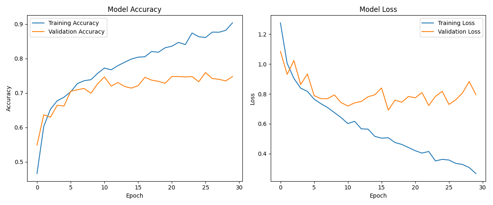

# Nhận diện loài hoa bằng CNN và Gradio

Ứng dụng web chạy cục bộ, cho phép tải ảnh lên và nhận diện một trong năm
loài hoa: hoa cúc, bồ công anh, hoa hồng, hướng dương và tulip. Ảnh không
được gửi ra Internet.

## Yêu cầu

- Python 3.9–3.11 (môi trường hiện tại đã được kiểm tra với Python 3.9.13)
- File mô hình `flowers_cnn_model.h5` đặt tại thư mục gốc của dự án
- Windows, macOS hoặc Linux; không cần GPU

Thứ tự nhãn đã được xác minh từ script huấn luyện và trực tiếp trên model:
`daisy`, `dandelion`, `rose`, `sunflower`, `tulip`.

## Cài đặt

Trên Windows PowerShell:

```powershell
python -m venv .venv
.\.venv\Scripts\Activate.ps1
python -m pip install --upgrade pip
pip install -r requirements.txt
```

File `.h5` được bỏ qua bởi Git để tránh đưa mô hình lớn vào lịch sử. Sau khi
clone repo, hãy tự chép `flowers_cnn_model.h5` vào cạnh `app.py`.

## Chạy ứng dụng

```powershell
python app.py
```

Trình duyệt sẽ mở `http://127.0.0.1:3000`. Ứng dụng chỉ lắng nghe trên máy
cục bộ và không tạo liên kết chia sẻ công khai. Dừng ứng dụng bằng `Ctrl+C`.

Nếu cổng 3000 đang được sử dụng, đổi `server_port` trong `app.py`.

## Kiểm thử

```powershell
python -m pytest -q
```

Các bài test đối chiếu pipeline Gradio RGB → BGR với pipeline OpenCV gốc trên
10 ảnh mẫu. Sai khác xác suất cho phép nhỏ hơn `1e-4`.

## Tiền xử lý khi dự đoán

1. Chuyển ảnh Gradio từ RGB sang BGR.
2. Resize về `180 × 180`.
3. Chuyển sang `float32` và chia `255.0`.
4. Thêm chiều batch thành `(1, 180, 180, 3)`.
5. Áp dụng softmax cho 5 logits của model.

`app.py` khởi chạy giao diện trong `ui.py`; phần dự đoán trong `predictor.py`
tải `flowers_cnn_model.h5` đúng một lần khi ứng dụng khởi động.
Ứng dụng hiện không dùng `flowers_cnn_model_flatten.h5`.

Vì chỉ biết năm lớp,
mô hình vẫn sẽ gán ảnh ngoài phạm vi vào một lớp; giao diện cảnh báo khi xác
suất cao nhất dưới 50%.

### Lưu ý khi chọn ảnh

Nên chọn ảnh có bông hoa rõ và chiếm phần lớn khung hình. Ảnh nhiều nền hoặc
hoa quá nhỏ có thể bị nhận nhầm; resize ảnh dọc/ngang về hình vuông cũng làm
thay đổi tỉ lệ đối tượng. Có thể cắt sát vùng hoa trước khi tải ảnh lên.
Trong trường hợp đã thử, ảnh bồ công anh bị nhận nhầm thành hướng dương ở
ảnh gốc nhưng được nhận đúng sau khi cắt sát bông.

Huấn luyện đã có `RandomZoom(0.1)` cùng các phép lật, xoay, thay đổi tương
phản và dịch chuyển. Các phép augmentation này chỉ hoạt động khi huấn luyện;
khi dự đoán, ứng dụng gọi mô hình với `training=False` và resize toàn bộ ảnh,
không tự cắt vùng hoa. Điểm softmax cao không bảo đảm dự đoán đúng; nâng
ngưỡng cảnh báo không làm tăng độ chính xác của mô hình.

## Huấn luyện lại

Dataset không được lưu trong Git. Để chạy `flowers_cnn.py`, tải Flowers
Recognition dataset và đặt ảnh theo cấu trúc:

```text
datasets/
└── flowers/
    ├── daisy/
    ├── dandelion/
    ├── rose/
    ├── sunflower/
    └── tulip/
```

Sau đó chạy:

```powershell
python flowers_cnn.py
```

### Kết quả huấn luyện đã lưu

Theo biểu đồ `model_performance.png`, độ chính xác ở epoch cuối xấp xỉ:

| Chỉ số | Độ chính xác |
| --- | --- |
| Huấn luyện (training accuracy) | 88% |
| Xác thực (validation accuracy) | 85% |



Các số trên được đọc xấp xỉ từ biểu đồ đã lưu, không phải kết quả đánh giá
lại file `.h5` hiện tại. Không dùng chúng thay cho độ chính xác trên tập test
hoặc mức bảo đảm cho từng ảnh người dùng tải lên.

Script chia dữ liệu theo tỉ lệ 70% train, 15% validation và 15% test, có
`stratify` theo nhãn và `random_state=42`. Huấn luyện tối đa 50 epoch, dùng
`EarlyStopping` theo `val_loss` với `patience=5` và `restore_best_weights=True`.
Vì vậy, mô hình được lưu dùng trọng số tại epoch có validation loss thấp nhất,
không nhất thiết là epoch cuối trên biểu đồ. Độ chính xác test được in ra
terminal sau huấn luyện; README chưa có số liệu test đã xác minh.

Để cải thiện trường hợp nhầm do nền hoặc kích thước hoa, bổ sung ảnh với nhiều
bố cục và các ảnh crop phù hợp vào tập train, rồi so sánh trên tập validation.
Giữ riêng tập test để đánh giá mô hình sau khi chọn cấu hình.
